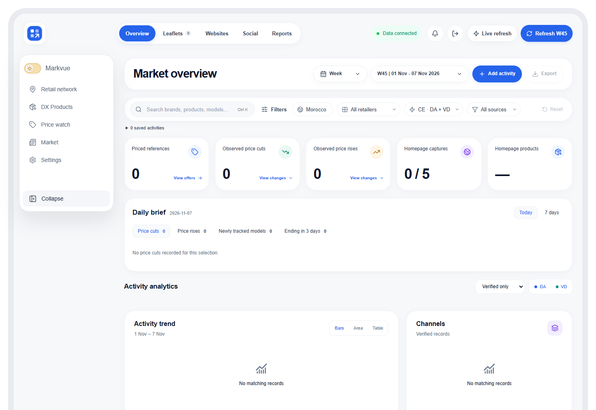
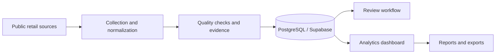
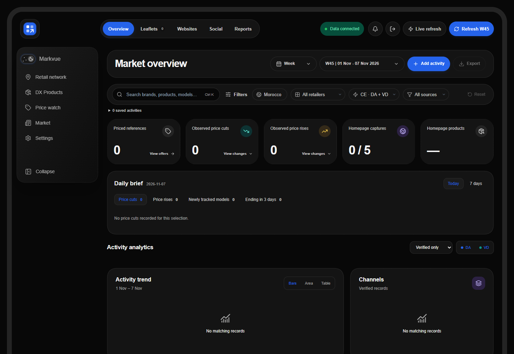
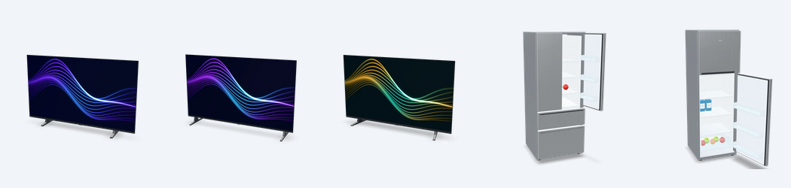

# Markvue — Retail Intelligence Platform

> Portfolio showcase only. The source code, production configuration, datasets, and credentials are private and are not included in this repository.

Markvue, formerly MarketSignal, is a **B2B retail-intelligence SaaS prototype** I built to turn fragmented public market activity into structured, reviewable business intelligence. It connects collection workflows, quality controls, historical records, dashboards, and reporting in one product.

## Business problem

Retail analysts need to follow changing prices, promotions, launches, campaigns, availability, and competitor activity across several public channels. Manual checking is slow, difficult to audit, and hard to repeat consistently.

## My contribution

- Designed the end-to-end analytics workflow and application experience
- Structured retail activities across MX, VD, and DA categories
- Built monitoring flows for public retailer pages, leaflets, brand websites, social activity, and ads
- Added validation, confidence scoring, evidence links, review states, and crawl history
- Designed KPI views for activity volume, offers, share of voice, discounts, retailer coverage, and price comparison
- Built export and recurring reporting workflows for CSV, HTML, and PowerPoint outputs

## High-level workflow

## Tools and methods

Next.js · React · TypeScript · PostgreSQL · Supabase · Crawlee · Playwright · Apify · GitHub Actions · PowerPoint generation

## Interface previews

The dashboard screenshots use an isolated empty-state preview of the current interface. The 3D images show original Blender product renders. Refrigerator interiors are illustrative. No production metrics, client records, credentials, or confidential source material appear.

## Ownership

This repository is a visual case study, not an open-source release. See [COPYRIGHT.md](COPYRIGHT.md).
